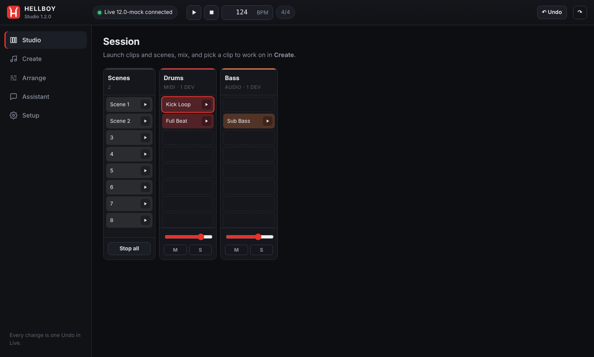
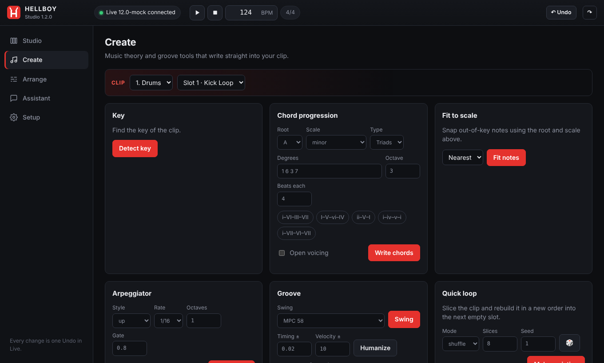
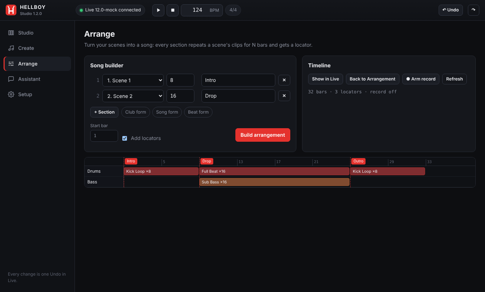

# Hellboy Prod

**Talk to your running Ableton Live session - from a desktop app, a coding
agent, or a hardware controller.**

Hellboy Prod gives software (and you) 117 precise tools over a live set:
tracks, clips, scenes, MIDI notes, music theory, devices, the browser,
automation, the mixer, the Arrangement View and a slice-and-shuffle loop
generator. You keep manual control, the project stays editable, and every
change is a single Undo in Live.

```
 Hellboy Studio (app) ─┐
 Claude Code / Codex ──┼─► remote script inside Live ─► your set
 TouchOSC / Max (OSC) ─┘
```

## Hellboy Studio - no terminal needed

Download from the latest release:

| Platform | File |
| --- | --- |
| macOS (Apple silicon) | `HellboyStudio-macOS-arm64.zip` |
| macOS (Intel) | `HellboyStudio-macOS-x64.zip` |
| Windows 10/11 | `hellboy-studio-win-x64.exe` |
| Command line (any platform) | `hellboy-<platform>` - see [Command line](#command-line-hellboy) |

1. Open the app. It opens in your browser (a private page on your own computer).
2. **Setup -> Install** copies the Live script into your User Library.
3. In Live: **Settings -> Link, Tempo & MIDI -> Control Surface -> HellboyProd**.

That's it. The status dot turns green and you get:



- **Studio** - the Session grid: launch clips and scenes, volume, mute, solo,
  new MIDI/audio/return tracks and scenes, transport, tempo, Undo.
- **Create** - detect the key, write chord progressions (triads to 9ths,
  inversions, open voicings), fit notes to a scale, arpeggiate, MPC swing,
  humanize, quantize, and make Quick Loop variations.
- **Arrange** - the song builder: pick scenes and bar lengths (or a Club /
  Song / Beat form) and it lays them out on the timeline with locators. A
  timeline view shows the result and jumps to locators.
- **Sounds** - search Live's browser (instruments, drums, effects, samples,
  plug-ins, your User Library) and load onto any track; see the device chain,
  bypass or remove devices.
- **Assistant** - ask in plain words, in any language ("write a dark minor
  progression on a new track and swing the drums"). It reads your set and makes
  the changes, showing each step. Uses your Anthropic API key, stored only on
  your computer.

First launch on macOS: the app is not notarized, so right-click it ->
**Open** once (or run `xattr -dr com.apple.quarantine "Hellboy Studio.app"`).
On Windows, SmartScreen may ask once: **More info -> Run anyway**.

| Create | Arrange |
| --- | --- |
|  |  |

The app runs in the background with no window of its own; it closes itself a
few minutes after its last browser tab closes. Open it again any time; a second
launch just brings the page back.

## Command line: `hellboy`

For the terminal, servers and scripts there is a CLI next to the app
(`hellboy-darwin-arm64`, `hellboy-darwin-x64`, `hellboy-win-x64.exe` in the
release; rename it to `hellboy` and put it on your PATH).

```bash
hellboy status                       # Live connection, script install state
hellboy install                      # copy the Live script
hellboy play | stop | undo | redo
hellboy tempo 124
hellboy tools chord                  # list tools (filter optional)
hellboy call notes_chords track=0 slot=0 root=A scale=minor progression=[1,6,3,7]
hellboy chat "make the drums swing like MPC 58"   # or just: hellboy chat
hellboy config --key sk-ant-...      # API key for the assistant
hellboy connect claude               # register the MCP bridge with Claude Code
```

### Manage it from the web

```bash
hellboy serve                        # web panel on http://127.0.0.1:7777 (no app window)
hellboy serve --lan --token my-long-secret
```

`serve` runs the same web panel as Hellboy Studio without opening a window, so
it suits a studio computer you control from elsewhere. With `--lan`, phones,
tablets and other computers on your network can open it (the printed link
includes the token). The **Console** tab runs any tool with the same syntax as
`hellboy call`.

Another machine can also send CLI commands to it:

```bash
hellboy tempo 128 --server http://studio.local:7777 --token my-long-secret
# or: export HELLBOY_SERVER=http://studio.local:7777 HELLBOY_TOKEN=my-long-secret
```

## Use it from a coding agent

In the app: **Setup -> Connect Claude Code / Connect Codex**, or write a
project `.mcp.json`. The app binary is the MCP bridge (`hellboy-studio --mcp`).
Without the app, use the standalone `hellboy-bridge` and `hellboy-installer`
binaries:

```bash
hellboy-installer-darwin-arm64 install   # remote script + Claude Code + Codex + .mcp.json
```

Claude Code is registered in user scope, so every project sees it.

## Tools

| Area | Tools |
| --- | --- |
| Session & transport | `session_state`, `session_overview`, tempo, signature, save, undo/redo, play/stop/seek/loop, stop all clips |
| Tracks | create MIDI/audio/return, delete, duplicate, rename, color, volume, pan, mute, solo, arm, sends, select, group, move, fold |
| Clips & scenes | create, delete, duplicate, rename, color, loop, markers, warp, fire, stop, transpose; scene list/create/delete/fire/rename/duplicate |
| Notes | get/set/add/clear, transpose, velocity, length, range, quantize, humanize, legato, shuffle |
| Theory | `notes_detect_key`, `notes_scale_fit`, `notes_chords`, `notes_arpeggiate`, `notes_swing` (13 scales, MPC presets) |
| Arrangement | `arrangement_state`, `arrangement_overview`, place session clips on the timeline, create MIDI/audio clips (Live 12), delete, read/write notes, record, back to arrangement, switch views, `arrangement_from_scenes` |
| Locators | `cue_list`, `cue_add`, `cue_jump`, `cue_rename`, `cue_delete` |
| Devices & browser | list, parameters, set (raw or normalized), bypass, delete, move, racks/chains, search and load from the browser |
| Automation | read, write, clear, list envelopes |
| Mix | report, auto balance, gain staging |
| Quick Loop | slice and rebuild a clip: shuffle, reverse, rotate, scatter |

Features that need a newer Live (for example arrangement clip creation needs
Live 12) answer with a clear reason on older versions instead of failing.

## OSC

The Live script also listens for OSC on `127.0.0.1:8972`, so TouchOSC, Lemur
or Max can call any tool:

```
/hellboy/transport_play
/hellboy/session_set_tempo 124
/hellboy/track_set_volume 2 0.7          positional arguments map to parameter names
/hellboy/notes_chords '{"track":0,"slot":0,"root":"A","scale":"minor"}'
```

Replies go to `/hellboy/reply <method> <ok> <json>` on the sender. Set
`HELLBOY_OSC_HOST=0.0.0.0` to accept controllers on your network,
`HELLBOY_OSC_REPLY_PORT` to reply to a fixed port, and `HELLBOY_OSC_PORT=0`
to turn OSC off.

## Build from source

```bash
npm install
npm run build        # mock-live, bridge, installer, app
npm test             # bridge + Hellboy Studio end-to-end tests against mock-live
npm run test:py      # loads the remote script the way Live does, fake Live API
npm run lint:py
npm run studio       # run Hellboy Studio from source
npm run bundle       # bridge/installer/app single-file bundles
```

Releases are built by `.github/workflows/hellboy-release.yml` (repo root) on a
`hellboy-v*` tag: binaries for macOS arm64/x64 and Windows x64, the macOS app
bundle, the remote script zip and `SHA256SUMS.txt`.

```bash
git tag hellboy-v1.3.0 && git push origin hellboy-v1.3.0
```

## Security

- Everything listens on `127.0.0.1` only (OSC on the network is opt-in).
- Hellboy Studio's API needs a random per-launch token, rejects other hosts
  (DNS rebinding) and other origins, and only runs registry tools with
  validated parameters.
- The API key is stored in `~/.hellboy/config.json`, readable only by you.

See `BUILD_GUIDE.txt` for the full build, run and troubleshooting guide and
`docs/DESIGN-1.2.md` for the design of this release.

## License

MIT - see `LICENSE`.
